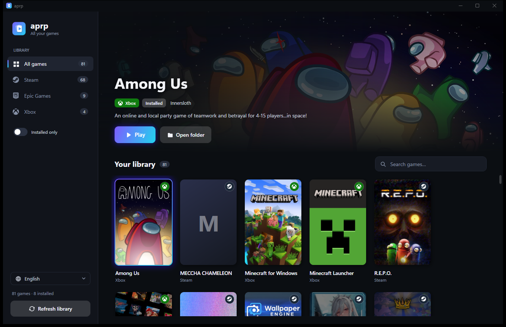
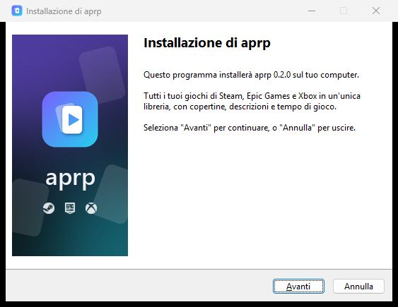

<p align="center">
  
</p>

<p align="center">
  <b>All your Steam, Epic Games and Xbox games in one library.</b><br>
  <a href="https://github.com/tipaccio-studio/aprp/releases/latest"><b>Download for Windows</b></a> ·
  <a href="docs/ARCHITECTURE.md">How it works</a>
</p>

<p align="center">
  
  
  
</p>



## Features

- **One library.** aprp finds your installed and owned games on **Steam**, **Epic Games** and **Xbox / PC Game Pass** automatically. You don't need to sign in or create API keys.
- **Play or install with one click.** Games launch through their own store, so DRM, updates, cloud saves and overlays keep working. For games you own but haven't installed, the button opens the store's install dialog.
- **Artwork and descriptions.** Each game gets a cover, a wide banner, its title logo, the developer and a short description, in your language when the store provides one.
- **Playtime.** A small native monitor sees when a game is running and how long you played.
- **Six languages:** Italiano, English, Español, Français, Deutsch and Português. You can switch from the sidebar without restarting.
- **Quick and private.** The library is cached locally, so after the first scan aprp opens straight away. The only network requests are for public store metadata.

## Install

1. Download **`aprp-setup-x.y.z.exe`** from [Releases](https://github.com/tipaccio-studio/aprp/releases/latest).
2. Run it and choose your language. By default it installs for your user only, with no admin rights.
3. Open **aprp** from the Start menu.

You don't need .NET or Python. There's also a portable **`aprp.exe`** that runs without installing anything.

> Until releases are signed, Windows SmartScreen may show a warning. Click **More info → Run anyway**.

**[Code signing policy](docs/CODE_SIGNING.md)** · **[Privacy](docs/PRIVACY.md)**

<p align="center"></p>

## Build from source

aprp is written in **C#** (WPF UI), **Python** (game detection and metadata) and **C++** (process monitor). See [docs/ARCHITECTURE.md](docs/ARCHITECTURE.md) for the design.

You need the .NET 10 SDK, Python 3.10+, the Visual Studio 2022 Build Tools (C++), CMake and, for the installer, Inno Setup 6.

```powershell
git clone https://github.com/tipaccio-studio/aprp.git C:\dev\aprp
cd C:\dev\aprp
.\build.ps1          # -> dist\aprp.exe and dist\aprp-setup-<version>.exe
```

For development, build the native DLL once, then run the app:

```powershell
cmake -S native -B native\build -A x64; cmake --build native\build --config Release
dotnet run --project src\Aprp.App
```

> Clone into a short path such as `C:\dev\aprp`. MSBuild fails when paths go over 260 characters.

## Project layout

```
src/Aprp.App/   C# WPF app: UI, launching, translations
scanner/        Python: Steam / Epic / Xbox detection, online metadata
native/         C++ DLL: finds and watches running game processes
installer/      Inno Setup script and wizard artwork
tools/          Generates the icon, banners and platform logos
```

## Code signing policy

Free code signing provided by [SignPath.io](https://about.signpath.io), certificate by [SignPath Foundation](https://signpath.org). Who builds, reviews and approves releases: [docs/CODE_SIGNING.md](docs/CODE_SIGNING.md).

## License

[MIT](LICENSE) © 2026 Tipaccio Studio. See [THIRD-PARTY-NOTICES](THIRD-PARTY-NOTICES.md) for the bundled components.
Steam, Epic Games and Xbox are trademarks of their respective owners. aprp is not affiliated with Valve, Epic Games or Microsoft.

---
